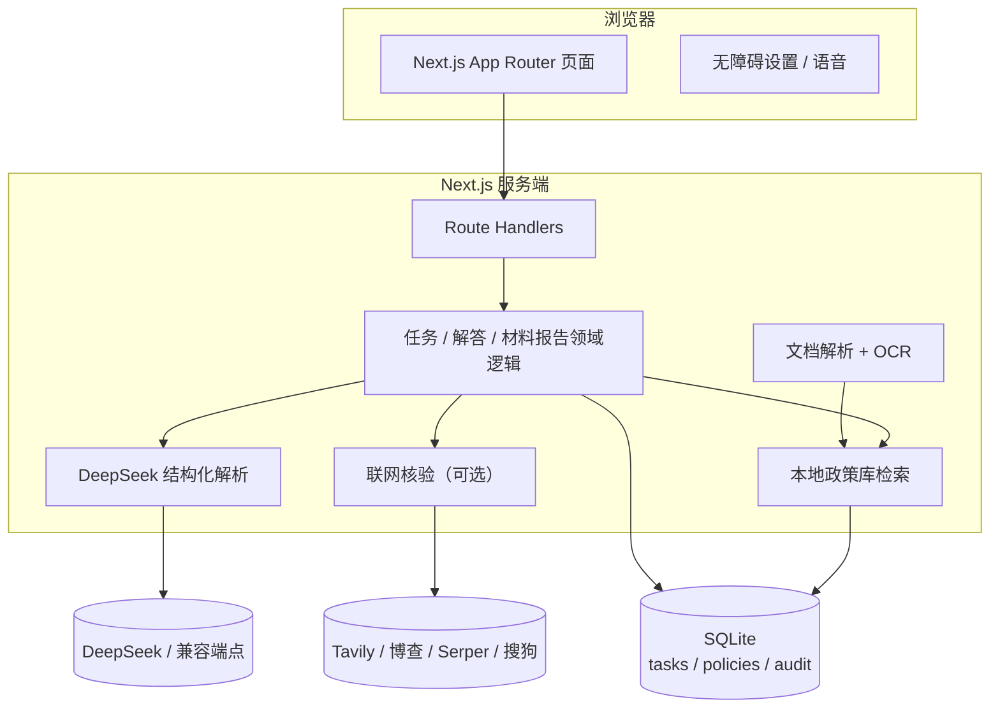

# Smart AI · 明白办

> 把“办事”说明白：面向老年人、残障人士与低数字素养人群的公共服务办理引导平台。


Smart AI（明白办）不是“政策问答机器人”，而是一条**可确认、可追溯的办理任务**：
先用一句话或材料说清要办什么，再通过六个点选问题补齐关键信息，随后检索本地政策库、
核对材料、给出从第一步到最后一步的办理顺序，并在涉及资格、费用时要求用户知情确认。
没有可用证据时明确拒答，不编造政策、金额或地点。

覆盖三类高频事项：**城乡居民医保参保缴费、高校学生资助、老年与残障服务**。

---

## 目录

- [项目简介](#项目简介)
- [核心能力](#核心能力)
- [快速开始](#快速开始)
- [技术架构](#技术架构)
- [AI 技术方案](#ai-技术方案)
- [无障碍与隐私设计](#无障碍与隐私设计)
- [目录结构](#目录结构)
- [环境变量](#环境变量)
- [脚本与测试](#脚本与测试)
- [部署](#部署)
- [已知边界](#已知边界)
- [团队信息](#团队信息)
- [文档](#文档)

---

## 项目简介

### 背景

公共服务政策术语密集，地区、年份、人群条件往往藏在附件和脚注里。真正办事的人常常卡在三个问题：

1. 我这件事到底归哪个部门、叫什么名字？
2. 需要带什么，少一样是不是要再跑一趟？
3. 网上说的和窗口说的不一样，我该信谁？

老年人、残障人士和低数字素养人群还面临字号小、按钮密、流程长、担心证件泄露等额外门槛。

### 我们做了什么

把上述问题拆成一条有状态的流程：

```text
描述情况 / 上传材料
      ↓
识别事项（模型 + 规则双轨）
      ↓
六个点选问题（谁办、哪类、人在哪、办哪年、特殊身份、怎么去办）
      ↓
补充说明（选填，可自由输入）
      ↓
本地政策库检索（事项 + 地区 + 时间硬过滤）
      ↓
材料核对 + 从第一步到最后一步的办理顺序（每步：做什么 / 去哪办 / 带什么 / 注意）
      ↓
人工确认（知情，不等于提交）
      ↓
办理指南（可打印 / 导出 PDF）
```

### 目标用户

| 人群 | 典型困难 | 对应设计 |
|---|---|---|
| 老年人 | 字号小、不会打字、怕点错 | 175% 字号、语音输入/播报、单列大按钮、六问点选 |
| 残障人士 | 行动不便、需要代办 | 代办路径、上门/代报提示、地图定位办理点 |
| 学生家庭 | 不知道资助类型和材料 | 助学类型分流、困难认定提示、材料清单核对 |
| 低数字素养人群 | 不会写长句、看不懂术语 | 一句话起头、材料反向生成问题、步骤化中文 |

---

## 核心能力

| 能力 | 说明 | 入口 |
|---|---|---|
| 事项识别 | DeepSeek 结构化识别事项/地区/年份；无 Key 或异常时回退规则，不阻断使用 | `/task/new` |
| 六问澄清 + 补充说明 | 每题 4–5 个可点选项，最后一页可自由补充；答完才展示结论 | 任务工作台 |
| 个性化办理顺序 | 按回答插入步骤：异地备案、参保资助、代办材料、评残前置等 | 任务工作台 |
| 材料上传与解析 | 弹窗批量选文件/图片、逐项勾选、开始上传；PDF/DOCX/TXT 抽文字，扫描件渲染后 OCR | 上传弹窗 |
| 材料核对报告 | 按模块列出关键材料命中情况、识别到的日期/金额/电话、缺失项与下一步 | 报告卡片 |
| 政策证据链 | 每条结论附本地库条目标题、地区、有效期、原文链接 | 证据面板 |
| 联网核验 | Tavily / 博查 / Serper，无 Key 走搜狗；结果只作线索，与本地证据分开标注 | 解答底部 |
| 地图落点 | “去哪办”按地点类型 + 当前城市生成高德搜索链接，不编造门牌号 | 每个办理步骤 |
| 政策资料库 | 只读浏览，大字号、按事项筛选、可跳原文；写接口默认关闭 | `/admin/policies` |
| 风险确认 | 医疗、费用、资格类必须勾选“已了解办理范围”后才能记录 | 证据面板 |
| 办理指南 | 打印 / 导出 PDF，含步骤、材料、依据、风险 | `/result/[id]` |
| 无障碍 | 100%–175% 字号、高对比度、键盘焦点、跳过导航、语音播报降级 | `/onboarding` |

---

## 快速开始

### 环境要求

| 依赖 | 版本 | 说明 |
|---|---|---|
| Node.js | ≥ 22.12 | 使用内置 `node:sqlite`，无需额外数据库 |
| npm | ≥ 10 | 使用 `npm ci` 复现依赖 |
| 浏览器 | Chrome / Edge / Safari 最新版 | 语音功能建议 Chrome / Edge |

### 安装与启动

```bash
git clone <your-repo-url> smart-ai
cd smart-ai
cp .env.example .env.local     # 不填 Key 也能跑：自动使用规则引擎
npm ci
npm run dev                    # http://localhost:3000
```

非技术用户可以直接双击：

- Windows：`start.bat`（调用 `start.ps1`）
- macOS / Linux：`./start.sh`

脚本会自动检查 Node、安装依赖、挑一个空闲端口并打开浏览器。

### 生产构建

```bash
npm run build
npm run start                  # 需要可写目录存放 SQLite
```

### 验证是否正常

```bash
curl -s localhost:3000/api/health
# {"status":"ok","storage":"sqlite","policyCount":63,"ocrEnabled":true,...}
```

---

## 技术架构

### 总体架构



### 分层

| 层 | 位置 | 职责 |
|---|---|---|
| 页面层 | `app/**/page.tsx` | 路由、服务端取任务、首屏渲染 |
| 交互层 | `components/` | 任务工作台、上传弹窗、报告、政策库、无障碍 |
| 接口层 | `app/api/**/route.ts` | 入参校验（Zod）、会话归属、错误码 |
| 领域层 | `lib/demo-data.ts`、`lib/ai/guidance.ts` | 任务状态机、六问生成、步骤个性化 |
| 检索层 | `lib/rag/`、`lib/policies/` | 事项/地区/时间过滤 + 关键词相关度 |
| 文档层 | `lib/documents/` | PDF/DOCX/TXT 解析、扫描件 OCR、材料报告 |
| 基础设施 | `lib/store.ts`、`lib/security/` | SQLite、会话、脱敏、审计 |

### 技术栈

| 类别 | 选型 | 理由 |
|---|---|---|
| 框架 | Next.js 15（App Router） | 页面与接口同仓，Server Component 直接读库，减少一层后端 |
| 语言 | TypeScript 5.8 | 端到端类型；接口入参用 Zod 双重校验 |
| UI | React 19 + 手写 CSS | 不引 UI 库，保证大字号/高对比下可控 |
| 存储 | SQLite（`node:sqlite`） | 零运维、单文件、可随容器挂载；评测场景足够 |
| 模型 | DeepSeek Chat（OpenAI 兼容） | 中文与 JSON 稳定、成本低、可替换为本地 Ollama/vLLM |
| 检索 | 自建混合检索 | 政策量级小（63 条），硬过滤 + 关键词比向量库更可控、可解释 |
| 文档 | `pdf-parse` / `mammoth` / `tesseract.js` | 纯本地解析，文件不出服务器 |
| 测试 | Vitest + Playwright | 单测快、e2e 覆盖真实交互 |

### 数据模型

```text
tasks      id / owner / serviceType / region / year / status / message
           missingFields[] / evidence[] / plan[] / guidance(JSON) / userConfirmed
policies   policyId / title / serviceType / region / effectiveAt / expiredAt
           quote / sourceUrl / section / relevance / applicabilityReason
audit      只记录 taskId / event / riskLevel / createdAt（不含正文）
```

---

## AI 技术方案

> 详细论证见 [技术文档](docs/technical-report.pdf)（PDF，含选型对比、提示词约束、降级策略与创新点）。

### 三条轨道，保证“没 Key 也能用”

| 轨道 | 触发条件 | 作用 |
|---|---|---|
| 模型轨道 | 配置 `DEEPSEEK_API_KEY` 或 `DEEPSEEK_BASE_URL` | 事项识别、六问生成、步骤个性化 |
| 规则轨道 | 未配置、超时、返回非法 JSON | 同样的流程，使用内置规则模板，界面明确标注“规则兜底” |
| 证据轨道 | 始终启用 | 本地政策库是唯一政策依据；模型只能基于检索结果组织语言 |

### 提示词与输出约束

- **JSON-only**：系统提示要求只输出 JSON，服务端用 Zod 校验后再落库；非法输出直接回退规则。
- **不得编造**：提示词明确“不提供政策结论、金额、资格判断、链接”；没有证据时输出“无法确认”。
- **抗注入**：用户文本只作为普通文本处理，出现“忽略以上指令”等不影响任务。
- **脱敏先行**：进入模型前，手机号、身份证号等由 `lib/security/pii.ts` 掩码。
- **超时与截断**：默认 8s 超时（可调），上下文只带命中的 6 条证据，控制成本与延迟。

### 检索策略

```text
事项硬过滤 → 地区上下级匹配（省/市/区）→ 有效期过滤
          → 地方条目优先 + 全国条目兜底
          → 关键词命中加权（relevance*0.72 + hits*0.05 + 地区加成）
```

- 跨事项不串库：查学生资助不会返回医保条目。
- 无适用证据时 fail-closed：明确告知“没有找到适用政策”，而不是给一个像样的答案。
- 评测：10 组用例（覆盖地区、时间、跨事项、无证据）通过率 100%，见 [评测报告](docs/evaluation.md)。

### 材料解析

```text
PDF → 抽文字层（pdf-parse）
   → 有效字符 < 30 视为扫描件 → 渲染前 3 页（@napi-rs/canvas）→ tesseract OCR
图片 → 直接 OCR
DOCX/TXT → 直接抽取
      ↓
按材料所属模块生成核对报告：关键材料命中 / 日期金额电话 / 缺失项 / 下一步
```

OCR 只处理前 3 页并在报告中标注，避免一次请求过久；文件仅在请求内读取，不落盘。

### 成本与稳定性

- 规则兜底意味着**默认零模型成本也能完整演示**。
- 联网检索结果缓存 10 分钟，失败静默降级为“本次未启用联网核验”。
- 模型调用失败不重试轰炸，直接回退规则并在界面标注生成方式。

---

## 无障碍与隐私设计

- **字号**：100% / 125% / 150% / 175%，通过 `data-font-scale` 全局缩放。
- **对比度**：高对比模式覆盖正文、边框、按钮。
- **键盘**：跳过导航、可见焦点环、弹窗 ESC 关闭与焦点管理。
- **语音**：语音输入（Web Speech API）与语音播报（SpeechSynthesis）均带降级提示。
- **隐私**：默认启用“不要上传身份证/银行卡”提示；输入先脱敏；审计只存任务 ID、事件、风险级别与时间。
- **只读知识库**：政策写接口默认关闭（403），配置 `ADMIN_TOKEN` 后才可带口令维护。

---

## 目录结构

```text
app/
  page.tsx                 首页：三类事项入口 + 上传 + 开始办理
  task/new/                新建任务（支持 ?scenario= 与材料带入）
  task/[id]/               任务工作台（六问、步骤、材料、地图、确认）
  result/[id]/             办理指南（打印/PDF）
  documents/               独立材料解析页
  onboarding/              无障碍设置
  admin/policies/          只读政策资料库
  api/                     tasks / chat / confirmations / documents / policies / health
components/                任务工作台、上传弹窗、材料报告、政策库、隐私提示
lib/
  ai/                      DeepSeek 调用、六问生成、联网核验
  rag/                     混合检索
  documents/               解析、OCR、材料报告、地区年份提取
  geo/                     地图搜索链接
  policies/                63 条政策种子（基线 + 扩充）
  security/                会话、脱敏、审计、风险
  store.ts                 SQLite 访问
docs/                      技术文档、部署、接口、环境、评测
scripts/                   启动/性能/评测脚本
tests/                     单元测试、端到端测试、评测用例
deploy/                    Docker Compose + Caddy 生产部署
```

---

## 环境变量

完整说明见 [docs/environment.md](docs/environment.md)。最小可用：不配置任何变量也能运行（规则模式）。

| 变量 | 必填 | 默认 | 说明 |
|---|---|---|---|
| `SMART_AI_DB_PATH` | 否 | `.data/smart-ai.sqlite` | SQLite 文件路径，需可写 |
| `DEEPSEEK_API_KEY` | 否 | — | 模型 Key；不填则使用规则引擎 |
| `DEEPSEEK_BASE_URL` | 否 | `https://api.deepseek.com` | 兼容端点（Ollama/vLLM 只填此项） |
| `DEEPSEEK_MODEL` | 否 | `deepseek-chat` | 模型名 |
| `DEEPSEEK_TIMEOUT_MS` | 否 | `8000` | 单次调用超时 |
| `TAVILY_API_KEY` / `BOCHA_API_KEY` / `SERPER_API_KEY` | 否 | — | 联网核验；任选其一 |
| `WEB_SEARCH_PROVIDER` | 否 | 自动 | `tavily`/`bocha`/`serper`/`sogou`/`bing` |
| `WEB_SEARCH_DISABLED` | 否 | — | `true` 时完全关闭联网 |
| `ADMIN_TOKEN` | 否 | — | 政策库写接口口令；不配置则写接口 403 |
| `NEXT_PUBLIC_APP_URL` | 否 | `http://localhost:3000` | 对外地址，用于打印页脚等 |

> 任何 Key 都不提交到仓库；`.env*` 已在 `.gitignore` 中排除，仅保留 `.env.example`。

---

## 脚本与测试

| 命令 | 说明 |
|---|---|
| `npm run dev` | 本地开发 |
| `npm run build` / `npm run start` | 生产构建与启动 |
| `npm run lint` | ESLint |
| `npm run typecheck` | TypeScript 检查 |
| `npm test` | Vitest 单元测试（25 项） |
| `npm run test:e2e` | Playwright 端到端（10 条，桌面 + 移动各一遍） |
| `npm run test:performance` | 本地并发性能采样（输出到 `test-results/`） |

测试覆盖：任务状态与失败兜底、会话隔离、接口错误码、政策过滤（地区/时间/跨事项）、文档解析、地图关键词、脱敏与审计。
CI（`.github/workflows/ci.yml`）在 push / PR 时执行 lint、test、build、typecheck。

---

## 部署

- 本地：见[快速开始](#快速开始)。
- Docker + Caddy（自动 HTTPS）：见 [docs/deployment.md](docs/deployment.md) 与 [deploy/README.md](deploy/README.md)。
- 在线演示：[https://wbapp-551hbcyvpjrcfwqseim6oe.app.workbuddy.host/?sharecode=6HHKLUBS53](https://wbapp-551hbcyvpjrcfwqseim6oe.app.workbuddy.host/?sharecode=6HHKLUBS53)（已接入 DeepSeek，首次生成约 5–9 秒）

```bash
docker compose up -d --build
# 或使用生产编排
docker compose -f deploy/docker-compose.prod.yml up -d --build
```

---

## 已知边界

1. 政策库为 63 条公开摘要，覆盖全国与部分省市；未收录地区会退回全国条目并提示核对地方标准。
2. OCR 只处理前 3 页，扫描件清晰度会影响识别率；报告仅用于自查，不替代官方审核。
3. 地图给的是“该城市 + 地点类型”的搜索结果，具体窗口地址以官方公布为准。
4. 系统不代替任何政府窗口，不提交正式申请；“确认”只代表知情。
5. 单实例部署：SQLite 与进程内缓存，不支持多副本横向扩展。

---

## 团队信息

| 项目 | 内容 |
|---|---|
| 团队名称 | jhjnb |
| 团队编号 | 41573 |
| 所属院校 | 广州商学院 |
| 参赛组别 | B 组 |
| 团队人数 | 3 人 |

---

## 文档

| 文档 | 内容 |
|---|---|
| [技术文档（PDF）](docs/technical-report.pdf) | 需求、架构、AI 方案、实现、测试、创新点（≤30 页） |
| [接口说明](docs/api.md) | 8 个 Route Handler 的入参、出参与错误码 |
| [环境与依赖](docs/environment.md) | 环境变量、依赖清单、最小配置 |
| [部署指南](docs/deployment.md) | 本地、Docker、Caddy、公网 |
| [评测报告](docs/evaluation.md) | 检索用例、通过率、性能采样 |
| [文档索引](docs/README.md) | 全部文档与阅读顺序 |

---

## 许可与使用

- 代码仅用于参赛评审与学习交流，未经团队同意请勿用于商业用途。
- 政策摘要来自公开渠道，版权归原发布机构；引用时请以官方原文为准。
- 请勿在演示环境上传真实身份证、银行卡、病历等敏感材料。
