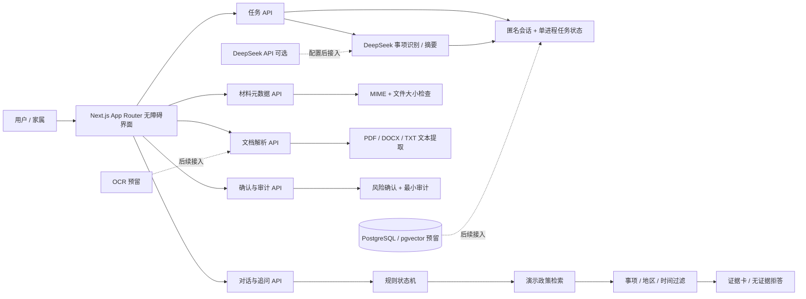

# Smart AI（明白办）

面向老年人、残障人士与低数字素养人群的无障碍公共服务办理引导平台。

项目把复杂的公共服务咨询拆解为一条**可确认、可追溯的任务**：识别事项、追问地区与年份、检索政策证据、检查材料元数据、提示风险并交由用户确认。没有适用证据时明确拒答，不给出未经核实的结论。

首期覆盖三类场景：城乡居民医保参保缴费、高校学生资助申请、老年与残障人士公共服务材料办理。

## 项目简介

### 背景

公共服务政策术语密集，地区、年份、人群条件往往藏在附件和脚注里；用户常常不知道先交什么、去哪里办、材料是否齐全。老年人、残障人士和低数字素养人群还面临字体小、操作复杂、担心证件泄露等额外门槛。

### 主要功能

- **事项识别与追问**：信息不全时先追问地区和年份，不直接下结论。
- **DeepSeek 事项解析（可选）**：配置 API Key 后，用 DeepSeek 识别事项类型、抽取已提供事实并生成一句话摘要；未配置或调用失败时自动回退规则。
- **政策证据链**：证据包含事项、地区、有效期、条款、来源和适用理由；地区或时间不匹配时返回空结果。
- **无证据拒答（fail-closed）**：检索不到适用证据时，明确告知无法确认，不编造政策。
- **材料元数据检查**：任务工作台只校验浏览器提供的文件类型与大小，不接收文件内容，不执行 OCR。
- **文档文本解析**：`/documents` 支持 PDF、DOCX、TXT 的文本提取；文件只在请求内读取，不保存，图片 OCR 未启用。
- **风险确认与最小审计**：医疗、费用、资格权益等场景必须人工确认；审计只记录任务 ID、事件类型、风险级别与时间。
- **无障碍支持**：100%–175% 字号、高对比度、键盘操作、语音输入/播报降级、家属协助清单。
- **匿名会话隔离**：HttpOnly Cookie；任务页面与变更接口校验会话归属。

### 演示说明

- 演示使用虚构人物、虚构地区和模拟政策条款，所有证据卡均标注“演示政策、虚构样例”。
- 任务工作台的材料检查只读取类型和大小；独立的 `/documents` 解析页会读取文本用于展示，但不保存文件。
- 用户确认只代表知情，**不等于正式提交**；系统不代替任何政府窗口。
- DeepSeek 仅用于事项识别与摘要，不生成政策结论；真实政策库、OCR 和持久化数据库尚未接入。
- 未配置 `DEEPSEEK_API_KEY` 时，系统自动使用规则解析，功能仍可运行。

## 技术架构

### 总体架构



### 技术栈

- **前端与服务端**：Next.js 15（App Router）、React 19、TypeScript
- **接口**：Next.js Route Handlers，Zod 校验输入
- **AI（可选）**：DeepSeek `deepseek-chat`，JSON 结构化输出；未配置时规则回退
- **文档解析**：`pdf-parse`（PDF）、`mammoth`（DOCX）、原生文本解码（TXT）
- **状态与会话**：单进程内存任务存储、HttpOnly 匿名会话
- **测试**：Vitest 单元测试、Playwright 端到端测试
- **构建与部署**：Next.js standalone、Docker、Docker Compose、Caddy
- **后续扩展预留**：Prisma / PostgreSQL / pgvector、真实政策库、图片 OCR

### 工程规范

- TypeScript + ESLint；API 输入统一使用 Zod 校验。
- 页面、组件、业务库、接口分层；关键边界有单元测试与端到端测试覆盖。
- 提交信息使用 `feat:`、`fix:`、`docs:`、`chore:` 前缀。
- 仓库保留完整 Git 提交历史，可追溯各阶段开发内容。

### 目录结构

```text
app/                 页面与 Route Handlers（含 /documents、/api/documents/parse）
components/          任务工作台、无障碍设置、文档解析、家属协助等组件
lib/ai/              Agent 状态流、DeepSeek 调用、结构化输出与提示词
lib/documents/       PDF / DOCX / TXT 文本提取
lib/rag/             政策证据类型与检索
lib/security/        PII 脱敏、风险规则、会话与审计
lib/api/             API 输入 schema
prisma/              数据模型（后续数据库扩展）
scripts/             演示启动与性能脚本
tests/               单元测试与端到端测试
deploy/              Docker Compose、Caddy、部署脚本
docs/final/          技术文档、架构图、演示脚本、验收清单
```

## 安装与运行指南

### 环境要求

- Node.js 22.12 或更高版本（推荐 22 LTS 或 24 LTS；仓库提供 `.nvmrc`）
- npm 10 或更高版本
- 可选：Docker 与 Docker Compose（用于容器部署）
- 可选：PostgreSQL + pgvector（当前演示未接入，仅为后续扩展预留）

### 安装

```bash
npm ci
```

如果 npm 下载较慢，可临时切换到国内镜像（仅影响本机 npm 配置）：

```bash
npm config set registry https://registry.npmmirror.com
npm ci
```

安装完成后如需要，可用 `npm config set registry https://registry.npmjs.org` 还原。

### 一键启动（推荐）

- Windows：双击 `start.bat`
- macOS / Linux：运行 `./start.sh`

首次运行会自动执行 `npm ci`，之后直接启动开发服务器并打开浏览器；端口 3000 被占用时会自动换到下一个可用端口。

如果不想自动打开浏览器：

```powershell
powershell -ExecutionPolicy Bypass -File .\start.ps1 -NoBrowser
```

### 环境配置

演示模式不需要真实密钥，可直接运行。需要自定义配置时：

```powershell
Copy-Item .env.example .env
```

或：

```bash
cp .env.example .env
```

### 启动

开发模式：

```bash
npm run dev
```

访问 `http://localhost:3000`，演示入口为 `/demo`。

生产模式本地演示：

```bash
npm run build
node scripts/start-demo.mjs
```

访问 `http://127.0.0.1:3107`。

Docker 单实例：

```bash
docker compose up -d --build app
```

### 验证

```bash
npm run lint
npm test
npm run build
npm run typecheck
npx playwright install chromium
npm run test:e2e
```

当前结果：21 项单元测试、16 项 Playwright 用例（桌面与 390px 移动端）。覆盖追问、跨地区无证据、会话隔离、超时重试、文件元数据、文档文本提取与确认不完成等边界。

### 部署

生产单实例（Docker Compose + Caddy 自动 HTTPS）见 [`deploy/README.md`](deploy/README.md)。

本项目是**单进程内存演示**，不支持多副本、负载均衡或 Serverless 部署；服务重启后任务会丢失。

## 环境变量

模板文件：`.env.example`。演示模式可全部留空；未配置 DeepSeek 时自动回退规则解析。

| 变量 | 必填 | 说明 |
|---|---|---|
| `DATABASE_URL` | 否 | PostgreSQL 连接串；当前演示未接入数据库 |
| `DEEPSEEK_API_KEY` | 否 | DeepSeek 密钥；配置后启用事项识别与摘要 |
| `DEEPSEEK_BASE_URL` | 否 | 默认 `https://api.deepseek.com` |
| `DEEPSEEK_MODEL` | 否 | 默认 `deepseek-chat` |
| `EMBEDDING_API_KEY` | 否 | 向量检索密钥；预留 |
| `STORAGE_ENDPOINT` | 否 | 对象存储地址；预留 |
| `STORAGE_BUCKET` | 否 | 对象存储桶名；预留 |
| `NEXT_PUBLIC_APP_URL` | 否 | 部署后的公开访问地址 |

`DEEPSEEK_API_KEY` 只在服务端读取，不会下发到浏览器；不要将真实密钥、真实证件或上传文件提交到仓库。

## 依赖清单

核心运行依赖（版本以 `package.json` 为准）：

- `next`、`react`、`react-dom`
- `zod`、`zustand`、`lucide-react`
- `pdf-parse`、`mammoth`（文档文本解析）
- `@prisma/client`（数据库扩展预留）

开发与测试依赖：

- `typescript`、`eslint`、`eslint-config-next`
- `vitest`、`@playwright/test`
- `prisma`、`tsx`、`@types/node`、`@types/react`、`@types/react-dom`、`@types/pdf-parse`

依赖锁定文件为 `package-lock.json`，安装时使用 `npm ci` 以保证可复现。

## 演示视频

- 录制操作手册（内部使用，视频完成后删除）：[`docs/录制脚本.md`](docs/录制脚本.md)
- 讲解稿：[`docs/final/demo-script.md`](docs/final/demo-script.md)
- 视频链接：待补充（提交前填写 Bilibili / 网盘链接）

建议录制路径：`/demo` 三类场景 → 事项识别 → 补地区与年份 → 证据卡 → 跨地区无证据 → 材料元数据 → 知情确认 → 家属协助。

## 团队信息

| 项目 | 内容 |
|---|---|
| 团队名称 | jhjnb |
| 团队编号 | 41573 |
| 所属院校 | 广州商学院 |
| 参赛组别 | B组 |
| 团队人数 | 3 人 |

## 相关文档

- [技术文档](docs/final/technical-document.md)
- [架构图](docs/final/architecture.md)
- [演示脚本](docs/final/demo-script.md)
- [验收清单](docs/final/acceptance-checklist.md)
- [部署说明](deploy/README.md)
