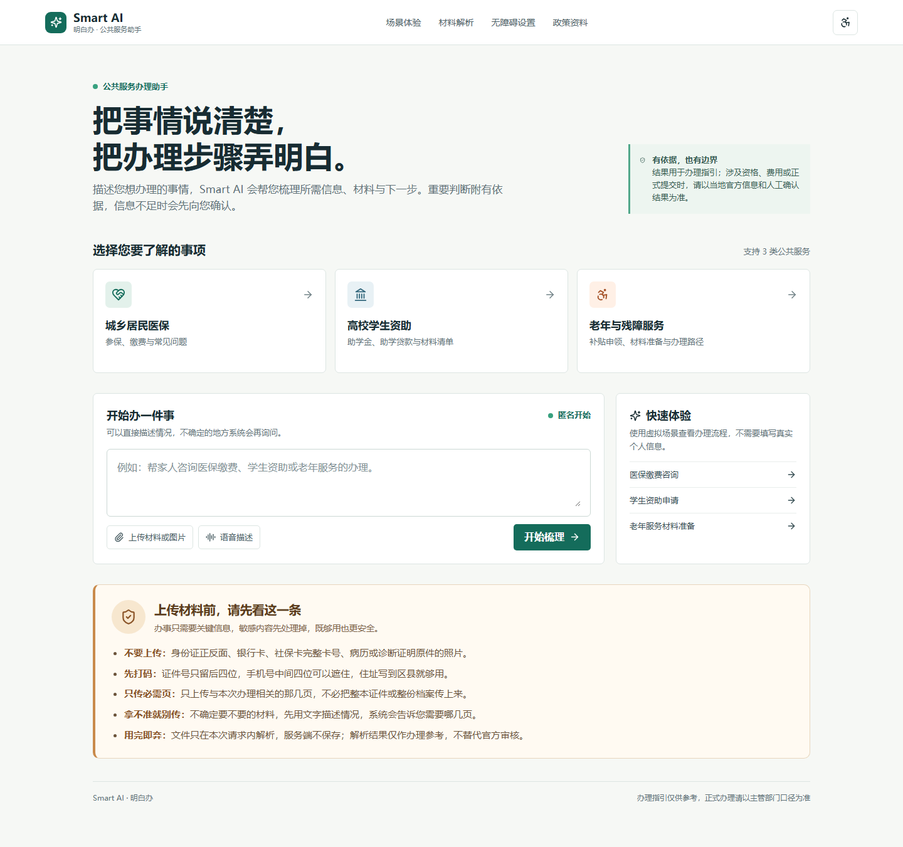
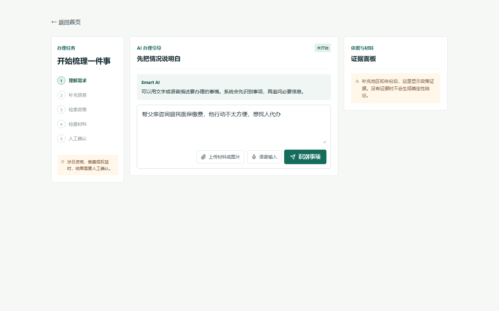
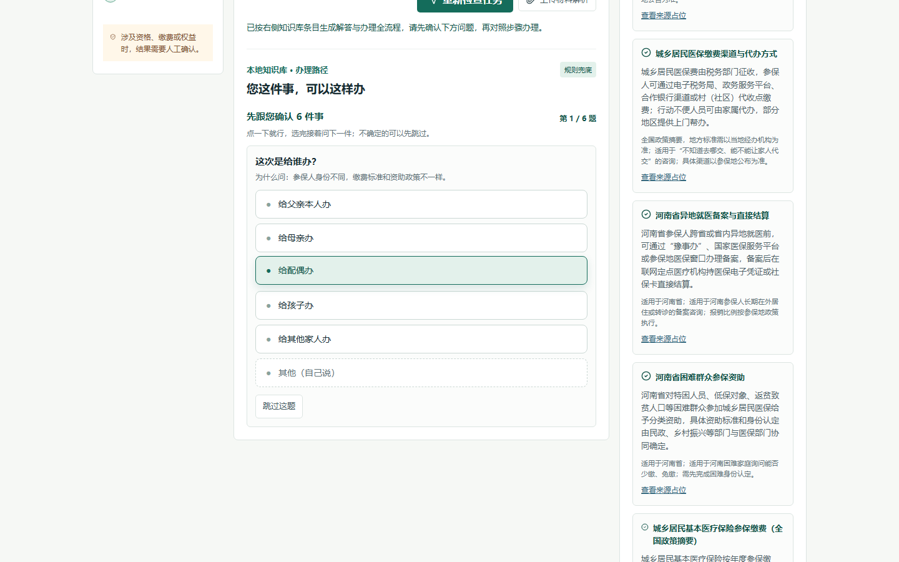
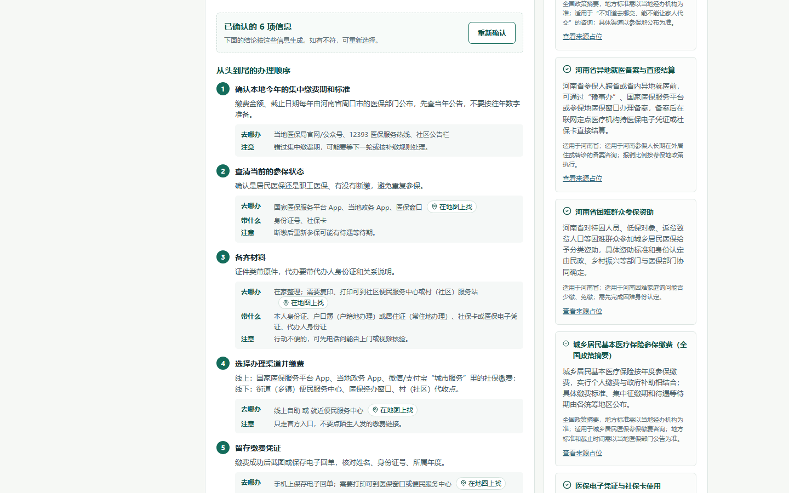
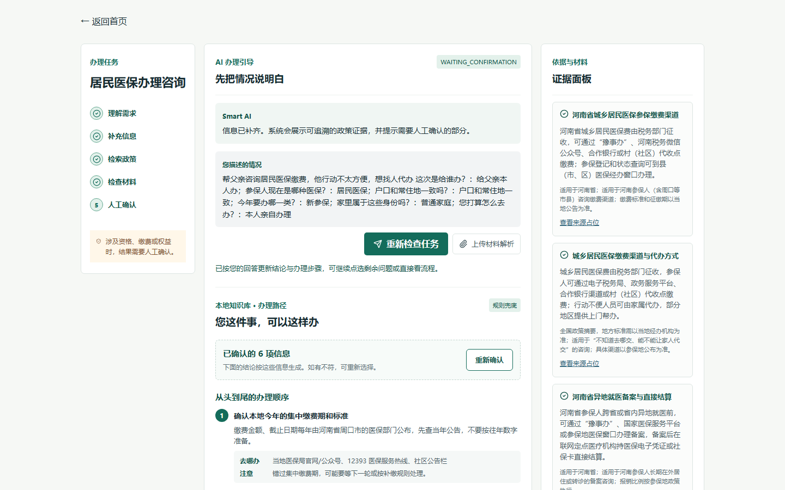
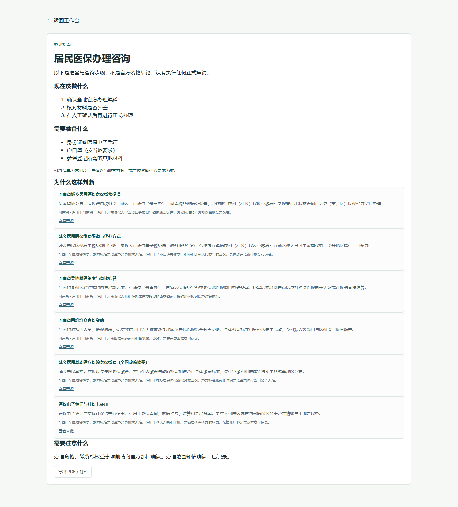
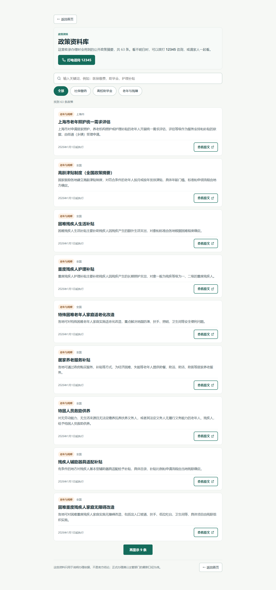
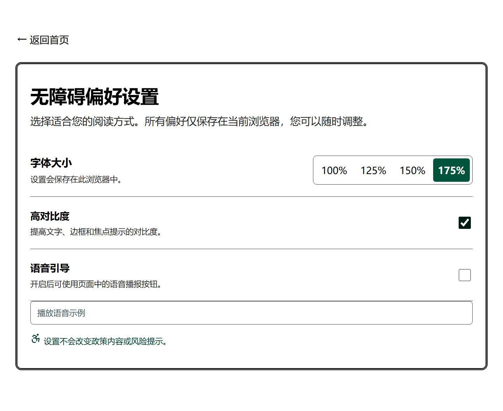

# Smart AI（明白办）· 作品介绍文档

| 项目 | 内容 |
|---|---|
| 作品名称 | Smart AI（明白办）——公共服务办理引导平台 |
| 作品形态 | 可在浏览器直接使用的 Web 应用（Next.js 全栈，单进程可离线运行） |
| 团队名称 / 编号 | jhjnb / 41573 |
| 所属院校 / 组别 | 广州商学院 / B 组 |
| 团队人数 | 3 人 |
| 代码仓库 | https://github.com/Git-985/Smart-AI |

---

## 一、项目详情及使用方式

### 1.1 项目要解决的问题

公共服务政策的原文通常写在政府网站的正文、附件和脚注里，地区、年份、人群条件层层嵌套。真正去办事的人往往卡在三件事上：

1. 我这件事到底归哪个部门、叫什么名字？
2. 需要带什么材料，少带一样是不是要再跑一趟？
3. 网上看到的说法和窗口说的不一样，应该信哪一个？

对老年人、残障人士和低数字素养人群，门槛更高一层：字号小、按钮密、流程长，还担心把身份证照片传出去。市面上多数"政策问答"产品只负责把一段文字说得更像人话，却不告诉用户下一步该去哪、带什么、找谁确认——用户看完仍然不敢去办。

### 1.2 我们做的产品

Smart AI 把"办事"当成一件**有状态、可追溯的办理任务**来处理，而不是一次问答。用户先用一句话说清要办什么（也可以直接上传材料），系统识别事项类型，再通过六个可点选的问题补齐关键信息，随后检索本地政策库、核对材料、给出从第一步到最后一步的办理顺序，并在涉及资格、费用时要求用户勾选"已了解办理范围"。没有检索到适用证据时，系统明确告知"没有找到适用政策"，不编造金额、地点或结论。

完整链路：

```text
描述情况 / 上传材料
      ↓
识别事项（模型 + 规则双轨）
      ↓
六个点选问题（谁办、哪类、人在哪、办哪年、特殊身份、怎么去办）
      ↓
补充说明（选填，可自由输入）
      ↓
本地政策库检索（事项 + 地区 + 年份硬过滤）
      ↓
材料核对 + 分步办理顺序（每步：做什么 / 去哪办 / 带什么 / 注意）
      ↓
人工确认（知情，不等于提交）
      ↓
办理指南（可打印 / 导出 PDF）
```

当前覆盖三类高频事项：**城乡居民医保参保缴费、高校学生资助、老年与残障服务**，本地政策库收录 63 条公开摘要，覆盖全国口径与部分省市。

### 1.3 三种使用入口

| 入口 | 适用的人 | 怎么用 |
|---|---|---|
| 在线演示 | 评委、初次体验者 | 打开演示地址，点选事项卡片或"快速体验"里的三个场景，无需注册 |
| 本地一键启动 | 非技术用户 | Windows 双击 `start.bat`，macOS / Linux 执行 `./start.sh`；脚本自动检查 Node、安装依赖、挑空闲端口并打开浏览器 |
| 源码启动 | 开发者、二次开发 | `npm ci` → `cp .env.example .env.local` → `npm run dev`，访问 `http://localhost:3000` |

不配置任何 API Key 也能完整走通全流程：系统自动切换到内置规则引擎，界面上会标注"规则兜底"，功能不缺失。

在线演示地址（已接入 DeepSeek，首次生成约 5–9 秒）：
https://wbapp-551hbcyvpjrcfwqseim6oe.app.workbuddy.host/?sharecode=6HHKLUBS53

### 1.4 一次典型使用过程（约 3 分钟）

1. **开口说事**。首页输入"帮父亲咨询居民医保缴费，他行动不太方便，想找人代办"，或点"语音描述"直接说；也可以先上传材料，让系统从材料里反推要办什么。
2. **确认事项**。系统识别出"城乡居民医保"，提示补充所在省市区和办理年份；识别不了具体事项时，会先追问一句"您具体想办哪件事"，而不是硬猜。
3. **回答六问**。每题 4–5 个大按钮，例如"这次是给谁办？"（给父亲本人 / 给母亲办 / 给配偶办 / 给孩子办 / 其他家人 / 其他，自己说），不确定可以跳过；最后一页可补充"父亲是低保户、我在外地只能周末回来"这类自由描述。
4. **看方案**。页面给出按回答定制的办理顺序：先去哪里确认缴费标准、怎么查参保状态、备哪些材料、线上还是线下缴、凭证怎么留；每一步都写清"去哪办 / 带什么 / 注意什么"，"去哪办"后面可直接点开地图搜索。
5. **核材料**。上传身份证、户口簿、缴费凭证的照片或 PDF，系统给出材料解析报告：哪些关键材料已命中、识别到的年度与电话、缺哪一项、下一步做什么。
6. **确认并带走**。勾选"已了解上述办理范围"后记录确认（只代表知情，不提交任何申请），进入办理指南页，可打印或导出 PDF，带去窗口。

### 1.5 明确的边界

产品不代替任何政府窗口，不提交正式申请，不承诺办成；金额、时限、资格以当地主管部门公布为准。OCR 只处理文件前 3 页，扫描件清晰度会影响识别率；政策库未收录的地市会退回全国条目，并提示核对地方标准。

---

## 二、项目的亮点

### 亮点一：把"问答"做成"可确认、可追溯的办理任务"

多数同类产品止步于"生成一段解释"，本项目的产出是一份带状态的任务：`理解需求 → 补充信息 → 检索政策 → 检查材料 → 人工确认`，每一步都能刷新恢复、能回看依据。用户关掉页面再打开，任务和结论仍在，不需要重新描述一遍。

### 亮点二：没有证据就不给结论（fail-closed）

每条结论都挂靠本地政策库的具体条目，附标题、适用地区、有效期和原文链接；检索不到适用条目时，界面直接显示"没有找到适用的政策证据"，并引导用户核对地方口径。系统宁可不答，也不给一个看起来很像样的编造答案——这是面向老年人和弱势群体的产品应有的底线。

### 亮点三：三条轨道并行，没有 Key 也能完整演示

| 轨道 | 触发条件 | 作用 |
|---|---|---|
| 模型轨道 | 配置了 DeepSeek Key 或兼容端点 | 事项识别、六问生成、步骤个性化 |
| 规则轨道 | 未配置、超时、返回非法 JSON | 同样的流程改用内置规则模板，界面标注"规则兜底" |
| 证据轨道 | 始终启用 | 本地政策库是唯一政策依据，模型只能基于检索结果组织语言 |

断网、没预算、模型抖动都不会让演示中断，这在学校答辩、社区推广等网络不确定的场景里尤其重要。

### 亮点四：为"不会打字的人"设计交互

- 一句话即可起头，不要求用户写出完整句子；
- 关键信息用点选而不是填空，六题全部为大按钮，单列排布，175% 字号下也不换行错位；
- 支持语音输入与语音播报（Web Speech API，带降级提示）；
- "去哪办"直接给地图搜索结果，不编造门牌号，也不让用户在多个 App 之间来回找。

### 亮点五：隐私做在流程里，而不是写在声明里

输入在进入模型前先做手机号、身份证号掩码；材料只在单次请求内解析，不落盘、不入库；审计表只记录任务 ID、事件类型、风险级别和时间，不存正文。首页在上传前就用一整块提示告诉用户"不要上传身份证正反面、银行卡、病历原件"。政策库写接口默认关闭，未配置口令一律返回 403。

### 亮点六：轻到可以离线跑，重到可以真部署

存储用 Node.js 内置 `node:sqlite`，一个文件即可；文档解析全部在本地完成（`pdf-parse` / `mammoth` / `tesseract.js`），不依赖任何外部文档服务。同一份代码既能双击脚本在本机跑起来，也能用 Docker Compose + Caddy 部署成带 HTTPS 的公网演示。

---

## 三、AI 测试技术落地使用情况

### 3.1 测试资产总览

项目把测试当作交付物的一部分，测试代码与业务代码同仓维护，任何人拉下代码都能复现结果。

| 层次 | 工具 | 规模 | 覆盖重点 |
|---|---|---|---|
| 检索评测 | 自研脚本 + JSON 用例 | 10 组 | 地区差异、时间有效性、跨事项隔离、无证据拒答、地方/全国兜底 |
| 单元测试 | Vitest | 25 项 / 9 个文件 | 任务状态机、会话隔离、接口错误码、政策过滤、文档解析、脱敏与审计 |
| 端到端测试 | Playwright | 10 条 × 桌面/移动两端 | 首页到指南全流程、材料解析、六问、兜底话术、无障碍、越权访问 |
| 性能采样 | 自研脚本 | 并发 4、20 次 | 创建任务 → 检索 → 出解答的耗时分布 |
| 持续集成 | GitHub Actions | 2 个 Job | lint / test / build / typecheck / e2e + 容器健康检查 |

### 3.2 AI 在测试环节具体做了什么

**（1）用例设计：AI 出初稿，人按风险定稿。**
把需求描述、接口约定和领域规则交给模型，让它按"正常路径 / 边界 / 异常 / 越权"四类生成用例清单，再由团队成员按业务风险删改。最有价值的是那些人手容易漏掉的边界：请求体是非法 JSON、上传 10 MB 以上的图片、把 A 会话的任务 ID 拿去 B 会话查、把"医保报销"的问题挂在"学生资助"事项下检索。这些用例最终都固化为 `tests/unit` 与 `tests/e2e` 中的真实断言。

**（2）断言编写：AI 提选择器与断言，真实浏览器验证后才保留。**
Playwright 用例里的定位方式（按 `aria-label` 取"所在省、市、区"、按 `role` 取"继续梳理"）由 AI 依据组件代码给出候选，团队成员在真实浏览器里跑通、确认不会因样式微调而失效后才写进仓库。选择器优先语义化，顺带把无障碍属性也约束住了——测试通过往往意味着屏幕阅读器也能读到。

**（3）评测集扩充：AI 批量扩写问题变体，人工标注预期答案。**
RAG 评测集原本只有 3 条手工用例。用模型围绕同一条政策改写提问方式（换地区、换年份、换称谓、故意跨事项），一次扩到 10 组，覆盖"北京 2026 年缴费""上海参保""异地就医备案""西藏 2024 年（已过期口径，应返回空）"等场景。**预期结果全部由人工核对政策原文后标注**，模型的输出只用来扩充输入，不用来判定对错，避免"用模型评模型"的自我循环。

**（4）缺陷归因：AI 读日志给假设，人做复现与修复。**
e2e 失败时保留 trace 与截图，把报错栈、失败步骤和相关组件代码一起交给模型，让它给出 2–3 个可能原因（例如"定位器匹配到隐藏的报告节点""滚动位置导致元素不可见"）。团队按假设逐条复现，确认后再改代码。AI 在这里的角色是缩短排查起点，不是替人下结论。

**（5）回归把关：AI 参与的改动同样要过 CI。**
CI 在每次 push 与 PR 上依次执行 lint → 单测 → 构建 → 类型检查 → 安装 Chromium 跑 e2e，并用 Docker 构建镜像后轮询 `/api/health` 验证容器可用。任何一处红灯都不合并，AI 辅助产出的代码没有例外通道。

### 3.3 落地效果

- 检索评测 **10/10 通过**：跨事项查询返回 0 条、过期条目被过滤、无证据时返回空数组并触发"无法确认"分支；
- 单元测试 **25 项用例保持通过**，覆盖任务状态流转、会话越权（返回 404 而非 403，避免探测）、脱敏与审计字段最小化；
- 端到端 **10 条用例在桌面与移动两种视口下各跑一遍**，其中"网络失败保留输入并允许重试""175% 字号 + 高对比度刷新后仍生效且页面不横向溢出"两条，是 AI 建议补充、人工确认有价值的用例；
- 测试过程中暴露并修正的问题举例：无地方条目时缺少"以当地为准"的提示、越权访问原本返回 403 反而暴露了任务是否存在（改为 404）、跨事项检索会把别的库条目带出来（改为事项硬过滤后返回 0 条）。

### 3.4 尚未做好的部分

1. 模型轨道与规则轨道的一致性只做了抽样对比，没有系统评测集；
2. 六问与步骤的"可理解性"仍靠人工走查，尚未邀请真实老年用户做可用性测试；
3. OCR 只在少量中英文样本上验证，多栏、表格、手写体的识别率会下降；
4. 性能数据仅反映本地规则模式，不含模型调用与 OCR 耗时，不作为线上 SLA。

---

## 四、项目中涉及的关键技术

### 4.1 技术栈与选型理由

| 类别 | 选型 | 为什么选它 |
|---|---|---|
| 框架 | Next.js 15（App Router） | 页面与接口同仓，Server Component 直接读库，少一层后端；首屏快，部署简单 |
| 语言 | TypeScript 5.8 | 端到端类型；接口入参用 Zod 双重校验，非法输入稳定返回 400 |
| UI | React 19 + 手写 CSS | 不引 UI 库，才能在 175% 字号与高对比模式下完全掌控布局 |
| 存储 | SQLite（`node:sqlite`） | 零运维、单文件、可随容器挂载；任务与政策量级用不上独立数据库 |
| 模型 | DeepSeek Chat（OpenAI 兼容） | 中文与 JSON 输出稳定、成本低，可替换为本地 Ollama / vLLM |
| 检索 | 自建混合检索 | 政策库仅 63 条，硬过滤 + 关键词加权比向量库更可控、更可解释 |
| 文档 | `pdf-parse` / `mammoth` / `tesseract.js` | 纯本地解析，材料不出服务器 |
| 测试 | Vitest + Playwright | 单测快；e2e 跑真实交互，顺带验证无障碍属性 |
| 部署 | Docker + Caddy | 一条命令拉起，Caddy 自动签发 HTTPS |

### 4.2 关键技术点

**（1）模型输出受约束，非法即降级。**
系统提示要求只输出 JSON，服务端用 Zod 校验结构与枚举值，校验失败、超时（默认 8 秒）、HTTP 异常一律回退规则引擎，并在界面标注生成方式。用户文本只当普通文本处理，提示中出现"忽略以上指令"之类内容不影响任务走向。

**（2）可解释的混合检索。**
检索不是向量相似度黑箱，而是三层显式规则：

```text
事项硬过滤 → 地区上下级匹配（省/市/区，含"河南省周口市"命中"河南省"）
          → 有效期过滤（无起始日期视为长期有效，过期条目一律排除）
          → 地方条目优先 + 全国条目兜底
          → 相关性加权：relevance × 0.72 + 关键词命中 × 0.05 + 地区加成
```

好处是每条结果都能回答"为什么给你看这条"，且在政策量级不大的阶段比调向量模型更稳定。

**（3）材料解析与 OCR 的取舍。**
PDF 先抽文字层，有效字符少于 30 个视为扫描件，再渲染前 3 页做 OCR；图片直接 OCR；DOCX / TXT 直接抽取。只处理前 3 页是刻意的工程取舍——避免单次请求过久，同时在报告里明确标注"仅解析前 3 页"。解析结果按材料所属模块生成核对报告：关键材料命中情况、识别到的日期金额电话、缺失项与下一步。

**（4）会话隔离与最小化审计。**
任务归属用 HttpOnly Cookie 承载的会话标识校验，不属于当前会话的任务一律返回 404 而不是 403，避免通过状态码探测任务是否存在。审计只写 `taskId / event / riskLevel / createdAt`，不落任何正文。

**（5）无障碍实现方式。**
字号通过 `html[data-font-scale]` 全局缩放（100%–175%），高对比模式覆盖正文、边框、按钮与焦点环；提供跳过导航链接、可见焦点样式、弹窗 ESC 关闭与焦点回收；语音输入与播报在浏览器不支持时给出降级提示而不是静默失败。

**（6）地点用"搜索"而不是"编造"。**
"去哪办"不生成具体门牌号，而是按地点类型 + 当前城市拼出高德搜索链接，线上办理步骤不出现地图。这样既解决了"我知道该去社保局但不知道哪个网点"的问题，也不会给出错误地址。

---

## 五、项目相关的图片与照片

以下截图均取自本项目的实际运行界面（生产构建，桌面 1440×900，中文界面），未做拼接或示意性修改。

### 图 1　首页：三类事项入口 + 一句话起头 + 上传前隐私提示



首页把"选择事项"和"直接描述"并列，降低起手门槛；下方用整块提示说明上传材料时不该传什么、该遮什么，把隐私教育前置到操作之前。

### 图 2　任务工作台：用一句话开始梳理



左侧是任务进度轴（理解需求 → 补充信息 → 检索政策 → 检查材料 → 人工确认），中间是描述框与"识别事项"，右侧证据面板在补充地区和年份后才出现内容，避免过早给出结论。

### 图 3　六问澄清：一次只问一件事，全部可点选



每屏只呈现一个问题，配"为什么问"的说明与"跳过这题"，右侧同步显示已检索到的政策依据；第六题之后可补充自由描述。

### 图 4　办理顺序：每一步都写清去哪办、带什么、注意什么



按用户回答插入个性化步骤（如代办需带代办人身份证、行动不便可电话问能否上门），"去哪办"后直接给出地图搜索入口。

### 图 5　证据面板与人工确认



右侧每条证据标注适用地区与适用理由，可跳原文；涉及资格与费用的任务必须先勾选"已了解上述办理范围"才能记录确认。

### 图 6　材料解析报告：命中、缺失与下一步


报告给出材料文件名、字数、来源（文本层 / OCR）与置信度，按模块列出关键材料命中情况、识别到的年度与电话，并提示"解析结果只用于自查"。

### 图 7　办理指南：可打印、可导出 PDF



指南页把"现在该做什么 / 需要准备什么 / 为什么这样判断 / 需要注意什么"放在一页，证据逐条列在下方，适合打印后带去窗口。

### 图 8　政策资料库：只读、可筛选、可跳原文



63 条公开政策摘要，按事项筛选，支持关键词搜索，只读浏览，不提供任何管理入口。

### 图 9　无障碍设置：175% 字号 + 高对比度



字号四档、高对比度、语音引导三项偏好保存在本机浏览器，设置不影响政策内容与风险提示的措辞。

---

## 六、项目之前是否发表过或获奖

**没有。** 截至本作品提交，本项目未在任何期刊、会议、竞赛或公开平台发表，也未获得任何奖项、软著或专利。仓库与在线演示仅用于本次参赛评审与学习交流；政策摘要均来自公开渠道，版权归原发布机构。

如后续有发表或获奖，将在仓库 README 与本文档中同步更新，不做追溯性修饰。

---

## 七、是否在其他项目基础上优化

**本项目为独立原创开发，不是在其它项目基础上优化的作品。** 具体说明如下：

1. **代码来源**：全部业务代码由本团队从零编写，仓库的提交历史即为完整开发过程，没有从其它仓库 fork 或拷贝业务模块。
2. **未基于往届作品或课程作业**：不存在"上一版本""改造自某比赛作品"的情况，也没有沿用其它团队的产品结构、界面或政策数据集。
3. **使用的仅是公开依赖与公开资料**：Next.js、React、TypeScript、SQLite、Zod、`pdf-parse`、`mammoth`、`tesseract.js`、Playwright、Vitest 等均为开源依赖，按各自许可证使用；政策摘要来自政府公开渠道，逐条标注来源链接。这些属于通用基础设施与公开信息，不构成"在其它项目基础上优化"。
4. **界面与文案**：视觉风格、交互流程、六问设计、报告结构与全部中文文案均为本项目原创，未套用任何现成模板或组件库主题。

因此，本文档不设"优化部分"章节；若评审需要，可提供仓库完整提交记录作为原创性佐证。

---

## 附：文档与代码索引

| 内容 | 位置 |
|---|---|
| 项目说明与快速开始 | `README.md` |
| 技术文档（PDF，≤30 页） | `docs/technical-report.pdf` |
| 接口说明（入参、出参、错误码） | `docs/api.md` |
| 环境变量与依赖 | `docs/environment.md` |
| 部署指南（本地 / Docker / Caddy） | `docs/deployment.md` |
| 评测报告（检索、单测、e2e、性能） | `docs/evaluation.md` |
| 测试代码 | `tests/unit`、`tests/e2e`、`tests/evaluation` |
| 部署编排 | `deploy/`、`Dockerfile`、`docker-compose.yml` |
